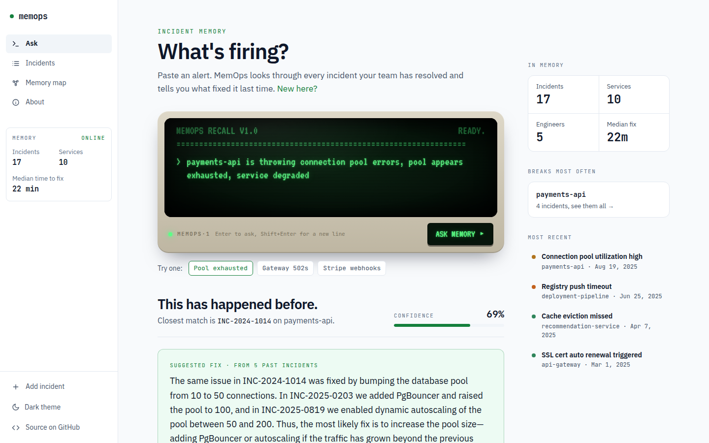
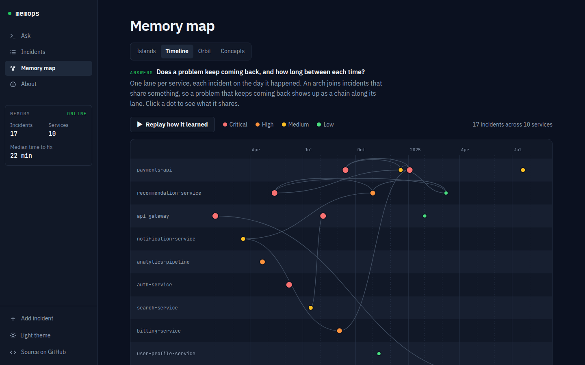
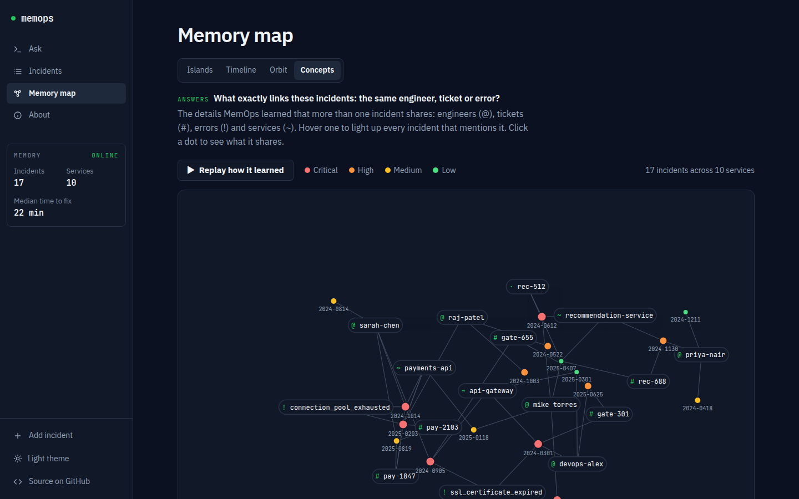

# MemOps

**Incident memory for on-call engineers.** Paste an alert, and MemOps tells you how your team fixed it last time, with the past incidents to prove it.

[Live demo](https://mem-ops.vercel.app) · [Backend API](https://beyanki-memops-api.hf.space) · Built with [Cognee](https://github.com/topoteretes/cognee)



## Why

Most production incidents have happened before. The fix usually exists, but it lives in an old Slack thread, a closed Jira ticket, or the head of someone who is asleep or has left. So whoever gets paged works it out again from scratch.

The demo data tells that story. payments-api ran out of database connections three times in ten months:

| Incident | Date | Fix |
|---|---|---|
| INC-2024-1014 | Oct 2024 | Raised the pool from 10 to 50 |
| INC-2025-0203 | Feb 2025 | Pool already at 50, so added PgBouncer and raised it to 100 |
| INC-2025-0819 | Aug 2025 | Replaced manual tuning with autoscaling between 50 and 200 |

Each fix built on the one before. MemOps keeps that history connected, so the fourth time it happens, the answer is already there.

## Features

- **Ask.** Paste an alert into the terminal. In about 10 seconds you get a verdict, a confidence score, a suggested fix based on past resolutions, and the closest past incidents with their match scores on a timeline.
- **Learn from confirmations.** Click "This fix worked" and MemOps re-indexes the graph around that incident, so the next answer is better.
- **Incidents.** Browse everything in memory with a monthly activity chart, filters by service and severity, and the patterns MemOps found. Each incident shows the fix, error log, Slack thread, Jira ticket and commits.
- **Memory map.** Four views of the knowledge graph, each answering one question:

  | View | Answers |
  |---|---|
  | Islands | Which services keep having incidents, and which incidents belong together? |
  | Timeline | Does a problem keep coming back, and how long between each time? |
  | Orbit | Which services are tied together by shared problems? |
  | Concepts | What exactly links these incidents: the same engineer, ticket or error? |

- **Add incident.** Log a resolved incident and it joins the graph straight away.
- Light and dark themes, and a layout that works on phones.

<p>
  
  
</p>

## How it works

MemOps stores each incident in a [Cognee](https://github.com/topoteretes/cognee) knowledge graph. All Cognee calls go through one file, `backend/services/memory_service.py`.

| Cognee call | What MemOps uses it for | Triggered by |
|---|---|---|
| `remember()` | Turns an incident (service, error, Slack thread, ticket, commits, fix) into one text block and adds it to the shared `incidents` dataset. Cognee extracts the entities, so incidents that mention the same service, ticket or engineer link through the same node. | Add incident, and seeding |
| `recall()` | Two searches per alert. `CHUNKS` ranks past incidents by embedding similarity. `GRAPH_COMPLETION` writes the suggested fix from the graph. | Ask |
| `improve()` | Re-runs enrichment and re-indexes the triplet embeddings around a resolved incident. MemOps records the graph's node and edge counts before and after, plus the same recall query before and after, and returns both in the API response. | "This fix worked", "Re-learn this incident" |
| `forget()` | Drops a named dataset. The shared `incidents` dataset is protected by a name check. | `POST /api/forget` |

The ranking is real vector similarity, not keyword matching. For the pool alert, the three pool incidents rank above INC-2025-0118, a stale-currency bug on the same service.

## Tech stack

| Layer | Choice |
|---|---|
| Backend | FastAPI, on a Hugging Face Space (Docker) |
| Memory | Cognee 1.2.2 with its embedded graph and vector stores |
| LLM | Groq, `openai/gpt-oss-20b` (any OpenAI-compatible endpoint works) |
| Embeddings | `all-MiniLM-L6-v2` through the Hugging Face inference API |
| Frontend | React 19, Vite, Tailwind, D3, deployed on Vercel |

## Running on free tiers

The live demo runs entirely on free plans, which shaped a few decisions:

- **Small prompts.** Groq's free tier allows 8,000 tokens a minute. MemOps turns off Cognee's session cache, which added a hidden second LLM call to every alert, and sends 8 graph triplets per recall in place of the default 15. An alert costs about 3,000 tokens. Set `CACHING` and `RECALL_TOP_K` to change this.
- **Instant restarts.** The Space wipes its disk on restart, and seeding 17 incidents through the LLM takes about 13 minutes and most of a day's token quota. So the image ships a prebuilt snapshot (`prebuilt/memops_snapshot.tar.gz`) of the graph, the incident store and the insights cache, and restores it in seconds. If the snapshot is missing, the backend seeds instead. Rebuild it with `build_snapshot.py` after changing `seed.py` or the embedding model.
- **Staying awake.** A GitHub Action (`.github/workflows/keep-awake.yml`) pings the backend every 12 hours so the free Space doesn't go to sleep.

## Run it locally

You need Python 3.12+, Node 18+, a Groq API key and a Hugging Face read token.

```bash
git clone https://github.com/YaseenBashaT/Hangover-MemOps.git
cd Hangover-MemOps
python -m venv venv && source venv/bin/activate
pip install -r requirements.txt
```

Create `.env` in the project root and copy it to `backend/.env` (the scripts read the first, the API server the second):

```
LLM_API_KEY=your_groq_api_key
LLM_PROVIDER=custom
LLM_MODEL=openai/openai/gpt-oss-20b
LLM_ENDPOINT=https://api.groq.com/openai/v1
HF_TOKEN=your_huggingface_read_token
EMBEDDING_PROVIDER=huggingface
EMBEDDING_MODEL=sentence-transformers/all-MiniLM-L6-v2
EMBEDDING_DIMENSIONS=384
```

Seed the 17 demo incidents (this wipes existing data), then start the API:

```bash
python reseed17.py
uvicorn backend.main:app --port 8000
```

In a second terminal, start the frontend and open http://localhost:5173:

```bash
cd frontend
npm install
npm run dev
```

## AI declaration

I built MemOps with Claude Code as my AI coding assistant, which the hackathon rules require me to state. It wrote and revised the backend, the Cognee integration and the React frontend under my direction, and I reviewed and tested each change before it went in.
